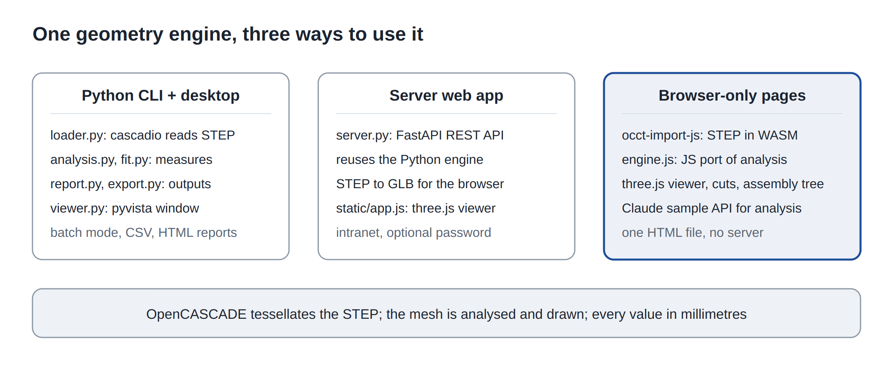

# STEP Viewer — Technical notes

One geometry engine, three ways to use it: OpenCASCADE tessellates the exact STEP geometry (B-rep) into a
triangle mesh; everything downstream (measurements, rendering, exports, AI prompts) works on that mesh. The kernel
runs in Python (`cascadio`), on a server (FastAPI) or inside the browser (`occt-import-js`, WebAssembly).
All values are millimetres.

## Reading STEP

- **Python** (`stepviewer/loader.py`): `cascadio.step_to_glb()` → GLB in metres → ×1000 → scene flattened,
  vertices welded (`merge_vertices`), normals fixed. Tolerances: `tol_linear` 0.2 mm (view) / 0.5 mm (batch),
  `tol_angular` 0.3 rad. GLB cached by path + size + mtime + tolerances.
- **Browser** (`standalone/src/*.js`): `occt-import-js` (7.6 MB WASM, gzipped to 3.1 MB and embedded as base64)
  decompressed with `DecompressionStream("gzip")` and passed as `wasmBinary`; no network request.
  `ReadStepFile()` returns meshes with names, normals, STEP colours, `brep_faces` ranges and the product tree.

## Analysis (`analysis.py` / `engine.js`, same results within 0.1 %)

| Quantity | Method |
| --- | --- |
| Dimensions | Axis-aligned bounding box (oriented box in Python only) |
| Volume | Signed tetrahedra Σ a·(b×c)/6, valid when watertight |
| Watertight | Every edge shared by exactly two triangles (after welding) |
| Wall thickness | 2·V/S, suppressed for bulky parts |
| Mass | Volume × density, 19 packaging materials |
| Packing | Six orientations in a grid, carton then pallet (euro/iso/us/demi_euro) |
| Overlaps | Pairwise bounding-box intersection |

## Server (`server.py`)

`POST /api/models` (upload → analysis + GLB) · `GET /api/models/{id}/model.glb` · `export.{stl|obj|glb|3mf|ply}` ·
`report.html` · `analysis.json` · `DELETE` · `POST /api/fit` · `GET /api/materials` · `/api/docs` (Swagger).
Optional HTTP Basic password via `STEPVIEWER_PASSWORD`. three.js is served locally (`static/vendor/three`).

## Viewer (`static/app.js`, `standalone/src/main.js`)

three.js r160, camera up = +Z, CSS2D labels for dimension lines drawn like a drawing. Section plane = one
`THREE.Plane` on every material; the cut face reads as solid because each mesh has a `BackSide` ochre twin.
Measure (raycast, two points), explode (radial offset), revision overlay (translucent red clone + delta table).

## Cut + AI page (`standalone/simple/`)

Three steps: file → cut at any angle (azimuth φ, elevation θ, `n = (cosθcosφ, cosθsinφ, sinθ)`, position along
`n`, flip) → AI. Saved cuts store plane, camera and hidden parts, persist in `localStorage`, and can be analysed as
a series (one capture per cut). The page uses the Claude artifact capability `sample` with images; it degrades to
"save the capture" outside claude.ai. The STEP product tree is shown with sums, instance badges, hide/select/rename,
automatic grouping (colour, name, volume, contact) and B-rep face hover; the indented tree is sent to the AI.

## Build (`standalone/`)

`npm run build` / `npm run build:simple`: esbuild bundles app + three + occt glue (~560 KB), gzip the WASM,
`build.py` injects CSS, JS and WASM into the template → one 4.7 MB HTML file.

## Tests

`python -m pytest` (engine, reports, exports, API, password) and `tests/ui/smoke.mjs` (headless Chromium with
software WebGL; needs the server on port 8765). Samples: `featuretype.step` (single part), `as1-assembly.stp`
(18-part assembly with instances and colours).

## Limits

Mesh-based (no feature tree, tolerance-bound measurements); units assumed mm; wall thickness is one number per
part; packing is a single-orientation grid; the AI only sees captures and numbers; instances detected by name +
mesh signature.
